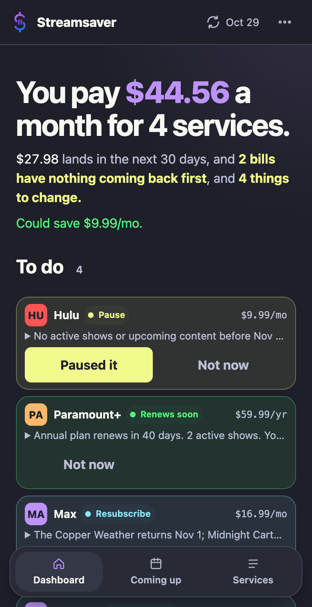
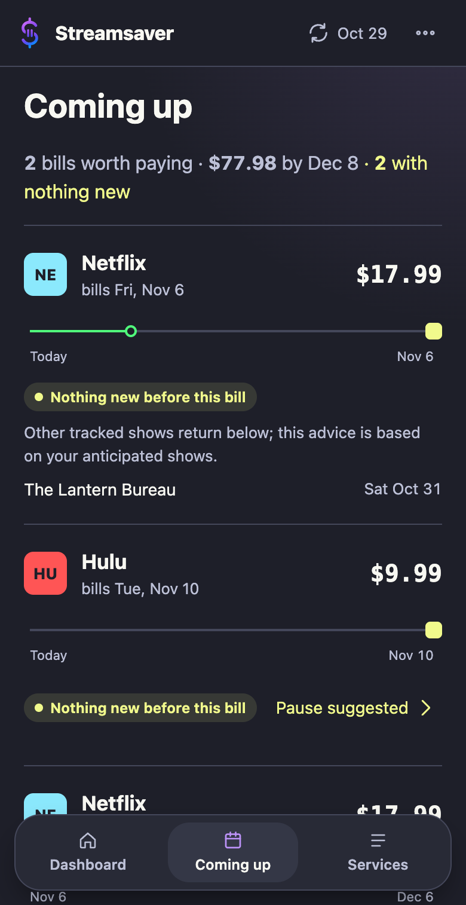
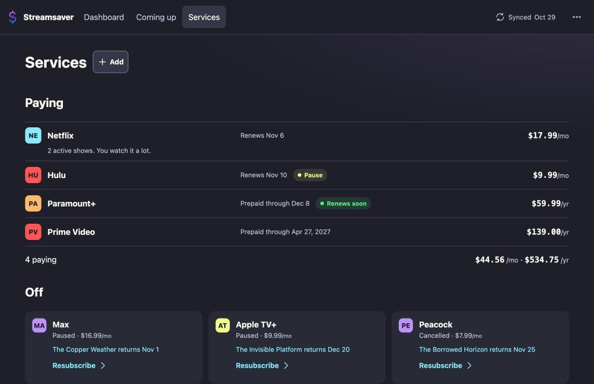

<picture>
  <source media="(prefers-color-scheme: dark)" srcset="assets/logos/streamsaver_header_transparent.png">
  <source media="(prefers-color-scheme: light)" srcset="assets/logos/streamsaver_header.jpg">
  
</picture>

Streamsaver is a self-hosted app that compares your Trakt viewing activity with your streaming bills to help you decide what to keep, pause, or restart.

<table>
  <tr>
    <td></td>
    <td></td>
  </tr>
  <tr><td>Dashboard</td><td>Coming up</td></tr>
  <tr>
    <td colspan="2"></td>
  </tr>
  <tr><td colspan="2">Services</td></tr>
</table>

## What it does

- Shows your monthly spend headline and the services behind it, including annual plans.
- Puts bills beside returning shows in Coming up: a bill is worth paying when something you watch comes back before it.
- Suggests subscription to-dos, with one-tap **Paused it** and **Not now** actions. You make the actual change with the provider.
- Sends email reports with weekly status alerts by default, plus Discord notifications for scheduled-job events and failures.
- Runs on your own server and encrypts API credentials at rest with your passphrase.

## Quick start (Docker)

Install Docker with the Compose plugin, then run:

```sh
mkdir streamsaver && cd streamsaver
curl -fsSLO https://raw.githubusercontent.com/noahphex/streamsaver/main/docker-compose.yml
curl -fsSLO https://raw.githubusercontent.com/noahphex/streamsaver/main/.env.example
cp .env.example .env
docker compose up -d
```

Open [http://localhost:8092](http://localhost:8092) and follow the setup wizard.
Choose a passphrase of at least eight characters, save your API details, and
complete Trakt authorization. Keep your passphrase: you need it to sign in.

The image runs as uid 1000. Compose creates persistent named volumes for
configuration, data, cached logos, and backups, with writable container ownership.
If you substitute host bind mounts, make those directories writable by uid 1000.

After setup, put the same passphrase in `STREAMSAVER_PASSPHRASE` in `.env` and run
`docker compose up -d` again if you want the scheduler to work unattended.
Without it, you can sign in and sync manually through the web app.

Use a home network, VPN, or reverse proxy with authentication.
See [Security](SECURITY.md) before choosing how to expose the app.

## What you'll need

1. **A Trakt account and API app.** Visit [your API applications](https://trakt.tv/oauth/applications)
   and choose **New Application**. Enter a name and set the redirect URI to
   `urn:ietf:wg:oauth:2.0:oob`. Copy **Client ID** and **Client Secret** into
   Setup, together with your **Trakt Username**.
   Click **Authorize Trakt**, approve access, and paste the returned PIN into
   **PIN From Trakt**. This matches the app's out-of-band authorization flow.
   If the PIN page stalls, leave the PIN blank and save; the Credentials page
   offers device-code sign-in at [trakt.tv/activate](https://trakt.tv/activate).
   Trakt may require developer verification before creating an API app; see its
   [authentication guide](https://developer.trakt.tv/docs/authentication-oauth).
2. **A TMDb API key.** In your TMDb account, open
   [Settings → API](https://www.themoviedb.org/settings/api), request a key if
   needed, and copy **API Key (v3 auth)** into Setup's **Read-Only API Key**.
   The app sends the key as `api_key`; use the API key rather than the API Read
   Access Token. See [TMDb authentication](https://developer.themoviedb.org/docs/authentication-application).
3. **Optional email reports.** Enable Google Account **Security → 2-Step Verification**,
   then open [App passwords](https://myaccount.google.com/apppasswords), create a
   password for Streamsaver, and enter your Gmail address and that app password
   in Setup. Leave both blank to skip email. The **Report Email** can be a
   different destination. See [Google's app password instructions](https://support.google.com/accounts/answer/185833).
4. **Optional Discord notifications.** Open your Discord server's **Server Settings →
   Integrations → Webhooks → New Webhook**, select a channel, and copy the webhook
   URL into Streamsaver **Settings → Notifications → Discord webhook URL**.
   See [Discord's webhook guide](https://support.discord.com/hc/en-us/articles/228383668-Intro-to-Webhooks).

Once signed in, use **Settings → Maintenance → Refresh provider list**, add your
subscriptions on **Services**, then run **Settings → Maintenance → Sync now**.
Set **Provider country** in Settings to match your region. Prices are entered
by you; provider names and show availability come from TMDb.

## Configuration

Copy `.env.example` to `.env` and edit the values you need. Keep `.env` private;
it is ignored by Git and excluded from image builds.

| Variable | Default | Purpose |
| --- | --- | --- |
| `STREAMSAVER_SECRET_KEY` | Blank | Optional session signing key. Blank generates and reuses `config/.secret_key` with mode 600. Known old defaults are rejected. |
| `STREAMSAVER_PASSPHRASE` | Blank | Optional credential unlock; required for unattended scheduler runs. Use the passphrase chosen in Setup. |
| `STREAMSAVER_SCHEDULER_RUN_AT` | `02:00` | Daily scheduler time in `TZ`; Compose passes it to `--run-at`. |
| `TZ` | `UTC` | Container timezone, including the scheduler's clock. |
| `STREAMSAVER_PORT` | `8092` | Published Docker port, or Flask's port when running locally. |
| `STREAMSAVER_VERSION` | `latest` | GHCR image tag, such as a released `1.2.3`. |
| `STREAMSAVER_HOST` | `0.0.0.0` | Local Flask bind address; Docker's Gunicorn bind stays fixed internally. |

Compose reads `.env` automatically; the local launcher loads it as shell assignments.
Quote values containing spaces or shell characters. Changing the session signing
key signs browsers out. Keep the generated key with your configuration volume.

Reports default to weekly status alerts. Change **Settings → Notifications →
Status alerts** to Daily, Weekly, Monthly, or Never. The scheduler still syncs
daily; actionable recommendations can appear between weekly status alerts.
Use Settings' test buttons to check email or Discord configuration.

## Running without Docker

Use Python 3.11 or newer from a source checkout:

```sh
python3 -m venv .venv
.venv/bin/pip install -r requirements.txt
cp .env.example .env
./run_streamsaver.sh
```

The launcher creates the venv if needed, installs requirements, loads `.env`, and
starts the Flask web app. Open `http://localhost:8092` and complete Setup.
Use `./run_streamsaver.sh web` explicitly, `./run_streamsaver.sh --scheduler` for
one scheduled job, or `./run_streamsaver.sh --help` for usage.
For an ongoing local schedule, invoke `scheduler.py --run-at 02:00` with the venv
Python and your passphrase in the environment.

## Building from source

Clone [the repository](https://github.com/noahphex/streamsaver) over HTTPS and
create a local `docker-compose.override.yml` in the checkout:

```yaml
services:
  streamsaver:
    build: .
    image: streamsaver:local
  streamsaver-scheduler:
    build: .
    image: streamsaver:local
```

Then run:

```sh
docker compose build
docker compose up -d
```

Compose automatically merges the override. The override file is ignored by Git,
so you can keep your own image tag or volume mappings locally.
The web app uses one Gunicorn worker because unlocked credentials live in process memory.

## Data and backups

- `config/` contains encrypted `credentials.enc`, its `.salt`, and the generated
  `.secret_key` used to sign browser sessions. Keep the passphrase separately.
- `data/` contains `streamsaver.db` with services, shows, settings, and cached
  provider metadata, plus application logs.
- `assets/logos/` caches downloaded provider logos. Missing logos show initials;
  the included Streamsaver brand images remain available.
- `backups/` is the directory reserved for server-side backup files.

In Docker these paths live in named volumes. Stop both services before making
filesystem copies of the database and config volumes.

Use **Settings → Maintenance → Export backup → Export** to download services
and settings as JSON. Restore with **Settings → Restore backup**. That export
excludes shows, credentials, salt, and the session key; it is not a full installation
backup. Settings can contain a Discord webhook, so protect exported JSON too.

## Updating

From the directory containing your Compose file:

```sh
docker compose pull && docker compose up -d
```

Back up your volumes first. Set `STREAMSAVER_VERSION` to a release tag to pin an
image instead of following `latest`.

## Development

Run the tests from the repository root:

```sh
python3 -m venv .venv
.venv/bin/pip install -r requirements.txt pytest
.venv/bin/python -m pytest -q
.venv/bin/python -m unittest discover -v tests
```

Start the isolated screenshot demo with one command:

```sh
docker compose -p streamsaver-demo -f docker-compose.demo.yml up --build -d
```

Open [http://localhost:8093](http://localhost:8093) and sign in with `demo`.
The demo binds only to localhost, creates seven services and 25 invented shows,
and writes fake encrypted credentials. Seeding makes no network requests; avoid
sync, provider refresh, and notification tests with these fake credentials.
The app generates a random session key in the throwaway config volume.
Every demo start resets its database and credentials. Destroy the demo and its volumes:

```sh
docker compose -p streamsaver-demo -f docker-compose.demo.yml down -v
```

For a local seed, run `scripts/seed_demo.py` with the venv Python and explicit
`--data-dir` and `--config-dir` paths. Existing databases or credentials are
protected unless you pass `--force`. The web app uses its normal `data/` and
`config/` paths, so use a disposable checkout for local screenshots.

## Attribution

This product uses the TMDB API but is not endorsed or certified by TMDB.
Trakt data comes from the user's own Trakt account.

[MIT License](LICENSE). Copyright 2026 Noah Lee.
